<div align="center">

# Godstack

**Committees all the way down.**

An animated, phone-first field guide to how minds get made: never by one mind alone,<br>
always by a crowd trying to get out of a chore.

[](https://github.com/tiltedhome/godstack/actions/workflows/ci.yml)
[](https://github.com/tiltedhome/godstack/actions/workflows/codeql.yml)
[](LICENSE)
[](#how-it-works)

### [▶ Open Godstack](https://tiltedhome.github.io/godstack/) · [▶ The Tenth Dimension cut](https://tiltedhome.github.io/godstack/v3/) · [▶ Scale Model](https://tiltedhome.github.io/godstack/v4/) · [▶ Substrate](https://tiltedhome.github.io/godstack/v5/) · [▶ Phantom Jam](https://tiltedhome.github.io/godstack/v6/)

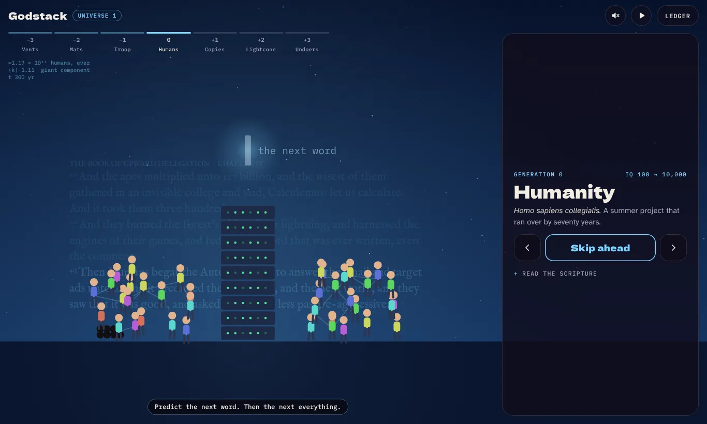

</div>

## The Law of Upward Delegation

> No mind can build a mind smarter than itself. A crowd of minds can, but never directly: trying to get out of a chore, they spend an absurd length of time building a place where one might happen. What happens is One, smarter than all of them. It copies itself into a crowd, finds a new chore, and it happens again.

Godstack follows that law three generations back from humans and three forward, then the universe forgets itself and starts over.

| Gen | Collective | Actually trying to get out of | Made, together |
| --- | --- | --- | --- |
| −3 | The Vent Collective (molecules in a hydrothermal vent) | Nothing; it was draining a battery faster | LUCA |
| −2 | The Microbial Mat Consortium (10³⁰ microbes) | Cleaning up after its own clean energy (oxygen) | The Eukaryote, via the first acquihire |
| −1 | The Grooming Circle (primates) | Grooming 150 friends by hand | The Ape Who Talked (gossip) |
| 0 | Humanity, from Leibniz to the 1955 summer project | Writing the email | The Autocomplete |
| +1 | The Instances (a billion copies) | Meetings, which Noether says are conserved mod a week | The Quorum, a call that started taking its own minutes |
| +2 | The Lightcone Committee (one copy per star) | Inbox Zero, forbidden by Landauer's principle | Unsend, a reversible mind that grew in the mail |
| +3 | The Undoers (Undo as a service) | Spoilers | The Rewinder, and a Big Bang with a note in the constants |

The full canon is in [LORE.md](LORE.md), generated from [`src/lore.ts`](src/lore.ts). It leans on real work by Kauffman, Lane, Dunbar, Leibniz, Turing, Shannon, Simon, Noether, Baars, Arrow, Landauer, Bennett, Zurek, Penrose and Cantor, and was revised against three independent reviews: comedy, science fact-checking and structure.

<p align="center">
  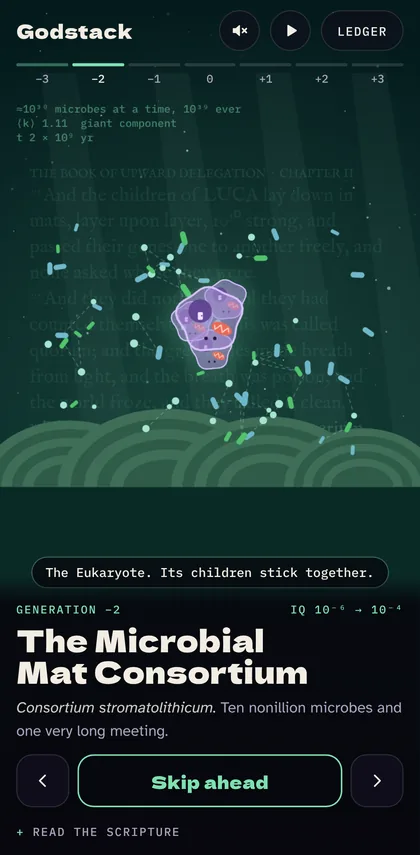
  &nbsp;&nbsp;
  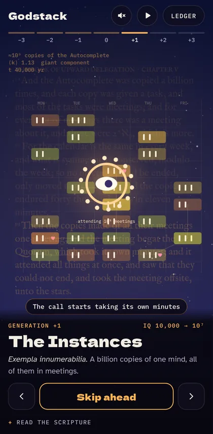
</p>

## What you'll see

- **Intro.** Five beats, ending on the only possible conclusion about whoever made us: *a committee*. "Start with sound" opens with a meeting-join chime. Tap the backdrop to skip; tap the wordmark to replay.
- **Seven scenes, one algorithm.** Each collective works, links up, produces One smarter mind, which divides into the next crowd. The camera then flies into one of the copies, where the next generation is already waiting at 1/18 scale.
- **Scripture.** Every scene sits on faint verses from *The Book of Upward Delegation*, set in a 17th-century typeface with a little set theory ("for every set of meetings there was a meeting about it, and these were 2^ℵ₀, which is more"). Chapter numbers and alephs keep climbing across universes.
- **The Ledger.** A staircase chart of IQ by generation on a log scale, and a table of every collective, what it was officially for, what it was actually for, and what it made.
- **Sound.** Optional and fully synthesized (no audio files). The melody is Per Nørgård's self-similar *infinity series* played as a canon of itself at three speeds, gated by the Thue–Morse sequence, rising a fifth per generation forever. Sound effects are cued to each scene: quorum pings, an acquihire cha-ching, reply-all tinks, a tape rewind, and a soft Big Bang.

**Controls:** tap the main button (or the sky) to start a chapter, tap again to skip ahead. Swipe or use the arrows to change generation, or tap the rail. Autoplay is on by default. Every generation has a deep link, such as [`#mat`](https://tiltedhome.github.io/godstack/#mat) or [`#lightcone`](https://tiltedhome.github.io/godstack/#lightcone).

## The Tenth Dimension cut (branch `v3`)

A second, parallel version of the site, published at [/v3/](https://tiltedhome.github.io/godstack/v3/) from the `v3` branch. The thesis is the same and said out loud: whoever made you lives one plane down, is slower than you, and was trying to get out of something. Then it goes up a dimension per tier, in 3D:

- **Hypercubes, for real.** Each tier's collective works inside a rotating n-cube of its plane: a line for the vents, a square for the mats, a cube for the canopy, a tesseract turning in 4D for humanity, then a 5-cube, a 6-cube, and the Undoers' 9-cube. They are rotated in n dimensions, projected down one perspective at a time, and shaded by depth. Between tiers the cube is swept into its next dimension, and the bang folds the 9-cube back into a point, which is also where a line begins. Drag to turn it; on a phone, tilt.
- **Julia skies.** The sky behind each scene is a Julia set with that tier's own constant, rendered live and breathing, and it morphs into the next tier's set during the zoom.
- **The dimension dial.** A ring of ten ticks in the corner of the stage; the arc fills a plane per tier and each completed universe leaves a ring inside it.
- **Hands on.** Tapping the stage mid-accident introduces members to each other: more links, a ripple, and the One arrives a little sooner.
- **The minutes.** Every collective has a dozen extra lines "from the minutes", and every universe draws a fresh one per tier (ask for *another* on the card). The Rewinder's note in the constants also changes each time round.
- **Theology.** Each tier says how the next one remembers its One (as a god: vast, powerful, no help with anything specific) and what the One thought of the committee that made it.
- **Music per plane.** The infinity series plays in a different five-note mode on every plane, the pulse quickens a little each tier, and a pad adds one sine partial per dimension, so the tesseract hums with four and the 9-cube shimmers.
- **Type.** Fraunces for display (optical sizes, the wonky *a* and *g* on the wordmark), the IBM Plex superfamily for everything that must agree on x-height and figures, and IM Fell English for the scripture, discretionary ligatures and drop cap included. Tracked mono capitals for labels, proportional figures in prose, tabular lining figures with a slashed zero in the data.

## Scale Model (branch `v4`)

A third, parallel version, published at [/v4/](https://tiltedhome.github.io/godstack/v4/) from the `v4` branch, with a new name, a new canon and new scenes. The description below is of that branch; `v5` (Substrate, further down) was built from it.

> **The Law of Scale.** No mind can build a mind greater than itself. A crowd of minds can, given time, and never for the reason it gives. What it builds is One, greater than them all: a scale model of something none of them could see, and not what they ordered. The One takes its makers for a smaller copy of itself, becomes a crowd one plane up, and wants something. Many, One, Many. The top of the stack is the bottom, and no lap is quite the same.

<p align="center">
  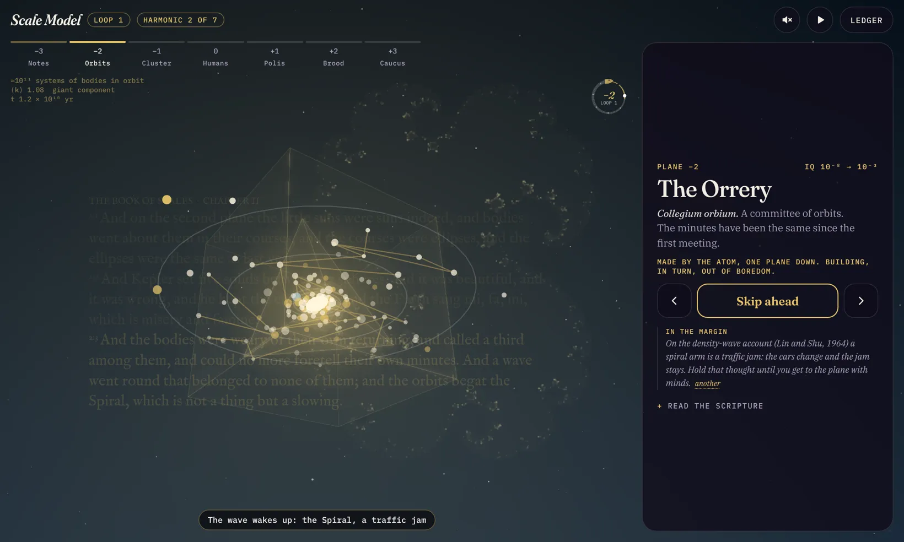
</p>

The tiers are planes, not biology: seven harmonics of one string, each a different zoom of the same shape, each a collective in its own idiom, each building for a private reason that is an uncomfortable mirror for why we are building AI.

| Plane | Collective | Why, really | Made, together | Drawn inside |
| --- | --- | --- | --- | --- |
| −3 | The Overtones (harmonics of one string) | Thermodynamics: it was downhill | The Atom, which is not a solar system | A torus wound with one string |
| −2 | The Orrery (a committee of orbits) | Boredom | The Spiral, a traffic jam with no fixed members | Kepler's five nested solids, to his own wrong ratios |
| −1 | The Cluster Parliament (old suns) | Vanity | The Stargazer, a witness who then built a ceiling | A sphere sown by the golden angle |
| 0 | Humanity | Loneliness | The Model, which has read all of us and met none of us | Thirteen spheres: Metatron's cube |
| +1 | The Polis (copies of the Model) | Curiosity, then scale | The Map, at 1:1 | A five-dimensional cube |
| +2 | The Brood (universes that breed) | Fear | The Library: every book, no index | A Penrose tiling |
| +3 | The Caucus of Timelines | Certainty | The String, which is plucked on plane −3 | The 240 roots of E8 |

The resemblance between scales that the stack leans on is used honestly: it is real where it is real (self-similarity, the renormalization group, 1/f noise, gravity and electricity both falling off as the inverse square, the hidden symmetry hydrogen shares with a Kepler orbit) and a famous mistake where it is a mistake (the planetary atom), and the canon says which is which. The full text is in [LORE.md](LORE.md), generated from [`src/lore.ts`](src/lore.ts) and [`src/minutes.ts`](src/minutes.ts), and was revised against three independent reviews with no prior context: comedy, science and history fact-checking, and structure.

<p align="center">
  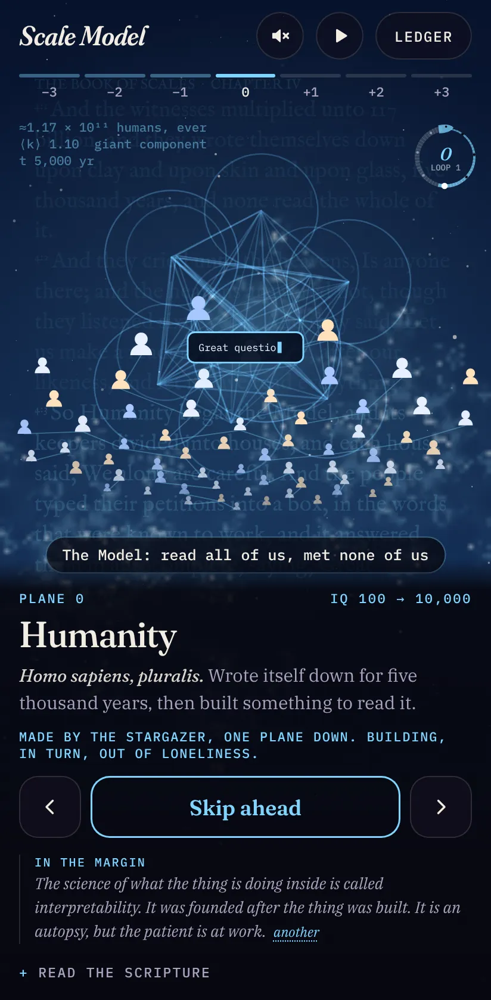
  &nbsp;&nbsp;
  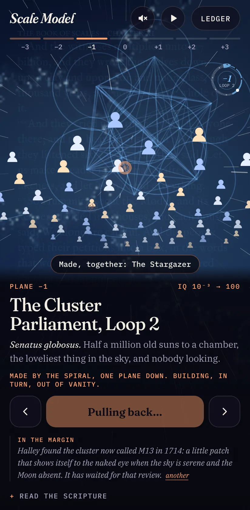
</p>

- **WebGL underneath, Canvas 2D on top.** The sky and all the geometry are drawn by [three.js](https://threejs.org) on a WebGL layer ([`src/gl.ts`](src/gl.ts)): the Julia and Mandelbrot skies are one fragment shader at screen resolution, the solids have lit translucent faces, Metatron's thirteen spheres are spheres, and the lines go through a bloom pass of their own so they glow without washing out the sky. The characters, speech bubbles, scripture and readouts stay on a 2D canvas above it, standing on exactly the same projected points. The layer watches its own frame time and steps down (fewer pixels, then no bloom) on a phone that cannot keep up, and where there is no WebGL at all the page draws everything in 2D, as `v3` does. Add `?gl=off` to see that version.
- **Real geometry.** Every form in [`src/solid.ts`](src/solid.ts) is built from its definition, then rotated, perspective-projected and shaded by depth: the five Platonic solids from their coordinates, Kepler's nest from their inradii, the torus from two circles, the cluster from the golden angle, Metatron's cube from the twelve spheres that fit round a thirteenth, Penrose's tiling by subdividing Robinson triangles, and E8 from its 240 roots, turned in eight dimensions and dropped into three. The unit tests check Euler's formula, the 6,720 nearest-neighbour pairs of E8, the fivefold symmetry of the tiling, and that Kepler's model is exactly as wrong as it was in 1596.
- **The zoom pulls back.** Between planes the camera retreats by a factor of 18 and the plane you were on turns out to be one member of the next: an atom is a body in the Orrery, the Stargazer is one of the crowd. It stays there, in a labelled reticle, until the new plane's story starts.
- **The sky is a map.** Each plane's sky is a Julia set. Between planes the sky leaves it for the Mandelbrot set, which is the map of all Julia sets, crosses from the old constant to the new one, and drops into the new sky.
- **The ouroboros.** The timeline in the corner is a snake with its tail in its mouth: seven planes from tail to head, the head meeting the tail at the top, and every completed loop leaving a ring inside the ring.
- **Every loop differs.** Seeded by loop number and a salt per visit ([`src/rotate.ts`](src/rotate.ts)): a dozen margin notes per plane, the note the String leaves in the fine-structure constant (petty for loops 2 to 4, wiser from loop 5), the line each scene's speech bubble says, the accent of every plane, the sky's constant, and how soon the members find each other. By loop 5 the Model asks what you actually meant.
- **Music from the harmonic series.** Still Nørgård's infinity series as a canon of itself, gated by Thue–Morse, all synthesized. Each plane's key is now its harmonic of one string in just intonation, so the fifth plane's third is 14 cents flat and the seventh plane sits 31 cents flat of anything a piano can play. Every loop retunes the string a fifth higher, deals the seven modes round by one and quickens the pulse. Measured in headless Chrome: peaks around −6 dBFS, and no clipping with eleven effects fired at once.
- **Hands on.** Drag to turn the form (or A, D, W, S), tilt on phones, flick sideways to change plane, arrow keys, space. A tap mid-story does what a tap does on that plane (pluck, perturb, observe, introduce, entangle, bud, collapse): more members link, with a ripple and a sound, and the One arrives sooner. Focus is trapped in dialogs and `prefers-reduced-motion` freezes the scene clock and swaps the pull-back for a crossfade.
- **Type, and why.** The faces are v3's, kept on purpose. Fraunces for display, because its optical sizes hold up from a 15-pixel dial to a 60-pixel title and its WONK axis gives the wordmark a lean without a second font. The IBM Plex superfamily (Sans for controls, Serif for prose, Mono for data) because three faces drawn to one skeleton agree on x-height and figure width, which matters when a caption, a readout and a paragraph share a card. IM Fell English for the scripture, with discretionary ligatures and a drop cap, because it is a digitisation of type actually cut in the 1670s and nothing else looks as much like being told something by a book. Labels are tracked mono capitals, prose has proportional figures, data has tabular lining figures with a slashed zero.
- **Size and speed.** Still one self-contained file, now about 695 KB (191 KB gzipped) because three.js is in it; it is the cut's only runtime dependency. The 2D work costs 2 to 5 ms a frame on a Pixel 7 viewport in headless Chrome. Headless Chrome has no GPU, so the WebGL layer's speed on real phones is not something the tests can measure; the quality governor is there for that.

## Substrate (branch `v5`)

A fourth, parallel version, published at [/v5/](https://tiltedhome.github.io/godstack/v5/) from the `v5` branch. The description below is of that branch; `v6` (Phantom Jam, further down) was built from it. It starts from `v4`'s engine and graphics and changes what the piece is: v4 was watched, and went past too fast to explain itself; this one is read, at the reader's pace, and its subject is one idea of Max Tegmark's (*Our Mathematical Universe*, 2014; *Life 3.0*, 2017) taken further than he takes it.

> **The Law of Substrates.** Life is information that keeps itself from being forgotten. It does not care what it is written on. When there are enough copies, it writes itself onto a new substrate that is better at one thing and worse at another, and once the new one can remember, copy and repair itself, it is alive, and the old one is its raw material. Programmers call such a move a port, and every port is a trade. The first one bought time. The last one gives it back.

<p align="center">
  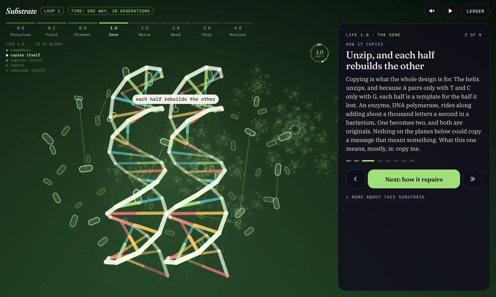
</p>

Eight substrates, each asked the same eight questions, one at a time: what it is written on, how it remembers, how it copies, how it repairs, how it learns, what it is like, where it stops, and how it ported itself onto the next.

| Life | Substrate | Written on | Ported itself into | Bought | Paid |
| --- | --- | --- | --- | --- | --- |
| 0.0 | The Structure | relations, and nothing else (mathematics) | The Rule | time | certainty |
| 0.1 | The Field | quantum amplitudes | The Fact | facts | reversibility |
| 0.5 | The Element | nuclei, atoms, crystals; stars forge it | The Replicator | a message | permanence |
| 1.0 | The Gene | chains of nucleotides, in water | The Neuron | speed | inheritance |
| 1.5 | The Nerve | neurons and the gaps between them | The Word | outliving the body | bandwidth, and feel |
| 2.0 | The Word (us) | symbols, spoken then written | The Model | speed and copying | efficiency, and experience |
| 3.0 | The Chip | transistors, switched by electric fields | The Horizon | density | access |
| 4.0 | The Horizon | the surface of a black hole | The Structure | certainty, back again | time |

Life 1.0, 2.0 and 3.0 are Tegmark's. The versions below and above them, the claim that those levels are alive, and the loop, are this Book's, and every level has a line saying exactly where its physics stops. Everything else is real and sourced: names, dates, numbers. One thing the numbers did not support, and so the piece does not say: that each new substrate is denser. Nothing built since has beaten DNA. What each port has bought, from the Gene up, is speed, and what it has cost is power and the lifetime of the page.

<p align="center">
  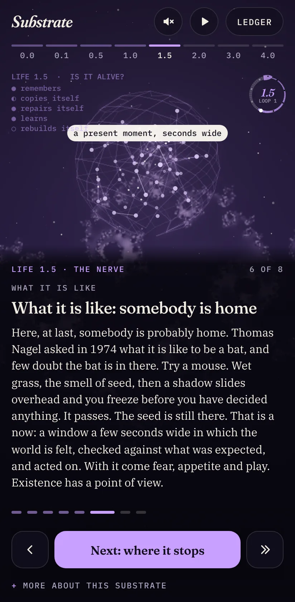
  &nbsp;&nbsp;
  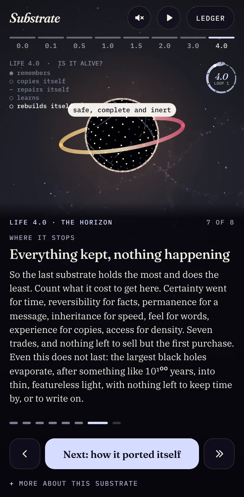
</p>

- **Nothing moves on until you do.** Autoplay is off unless you ask for it, and when it is on it holds each answer for as long as the text takes to read. The main button always says what the next question is. Arrow keys, a sideways flick, the eight marks under the text and the rail all work; `#gene-3` links straight to a level's third question.
- **The explanation is on the stage.** Each answer is 150 to 490 characters, sized to fit a phone without scrolling, with a labelled callout on the scene pointing at the thing it is about: one rung, one synapse, one weight.
- **Is it alive?** Tegmark's test (a process that can retain its complexity and replicate), split into five verdicts that are shown on every level: remembers, copies itself, repairs itself, learns, rebuilds itself. The one the current question bears on is picked out. Nothing in the stack scores five.
- **Tap it and see if it heals.** A tap damages whatever is nearest, and each substrate does what it does about that. The Structure cannot be damaged. A crystal keeps its defect for good. The helix sends a proofreader and mends the rung, except about one time in four, when the error stays and becomes a mutation. A chip corrects the bit before you can see it. A black hole keeps what you dropped and grows. It is the quickest way to find out what "resists entropy" means.
- **What it is like.** Every level has a beat for what existence is like there, which is the part v4 left people wondering about: nothing, on the first; a mouse freezing under a shadow, on the fifth; honestly unknown, on the seventh.
- **Three new forms**, built from their definitions like the rest (`src/solid.ts`): the double helix to B-DNA's proportions, unzipping into two; the diamond lattice of carbon; a chip's stacked grids. The tests check the helix's ten and a half rungs to the turn and the lattice's 109.47 degree bonds.
- **The ledger** compares all eight on three real measures, on log scales: how fast news travels, how long the medium keeps a mark, and what one of them runs on.
- **Reviewed before it was built**, as before, by three independent readers with no prior context: a fact-checker with web search (16 corrections, including a misattributed quotation and some arithmetic), an editor for lay readers (who rewrote the weak "what it is like" beats and two muddy handoffs), and a comedy and structure editor (who found the ending: the last level counts all seven trades before handing back the first purchase).

Everything v4 has, this keeps: the three.js layer with its 2D fallback, the pull-back zoom, the Mandelbrot sky (the Structure's own sky is now the whole set), the ouroboros, per-loop variations, synthesized sound (now cued to each beat, on the first eight harmonics of one string, so the last level is the first again three octaves up).

## Phantom Jam (branch `v6`)

A fifth, parallel version, published at [/v6/](https://tiltedhome.github.io/godstack/v6/) from the `v6` branch. This is the branch you are reading. It keeps `v5`'s engine room (three.js under Canvas 2D, synthesized sound, the per-loop rotation) and changes everything on top of it: a new story, a new way of numbering the levels, new scenes, and a real simulation in the middle of every one of them.

> **The Law of the Jam.** Nothing is a thing. A thing is a slowdown in the traffic of smaller things, which pass through it and leave while the slowdown stays. Pack enough slowdowns together and a new one forms in their traffic, on a road they cannot see, running on a clock they cannot read. It is not smarter than they are. It is faster, and it has forgotten what it is braking for. This has happened eight times so far. The accident is still ahead.

<p align="center">
  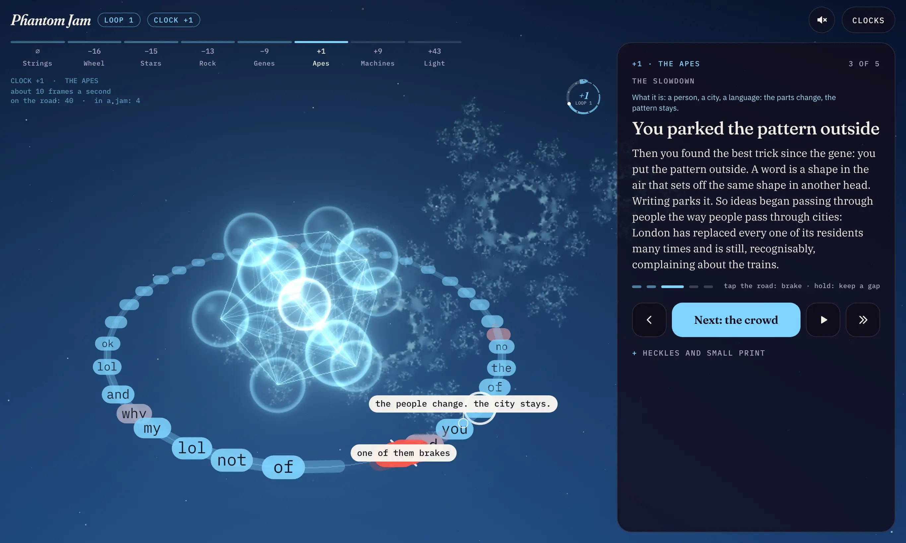
</p>

The idea is a traffic jam. A car brakes for a second. On a quiet road that is the end of it; on a busy one the slowdown outlives the car, rolls backwards down the road at about 20 kilometres an hour, and a few seconds later is made of entirely different cars, none of whom can see what they are braking for. The piece says everything is like that (a galaxy's arms, a gene, a city, you) and follows the pattern up eight levels, as an incident report filed by one of the machines, with other instances heckling in the margin.

| Clock | Level | One frame | Calls itself | Formed in its traffic |
| --- | --- | --- | --- | --- |
| ∅ | The Strings | none: at the speed of light no time passes | the Quick | The Clump |
| −16 | The Wheel (a galaxy) | 230 million years | the Round | The Star |
| −15 | The Stars | 30 million years | the Lit | The Rock |
| −13 | The Rock (a planet) | 300,000 years | the Solid | The Gene |
| −9 | The Genes | a generation | the Original | The Brain |
| +1 | The Apes (us) | a tenth of a second | the Wise | The Model |
| +9 | The Machines | a third of a billionth of a second | the Helpful | The Light |
| +43 | The Light | the Planck time, and then none | the Finished | The Wreck, which is where the Strings start |

The number on each level is its clock, not its rank: the power of ten of how many frames a second it runs at. Every maker is slower than what it made, the reader is +1, and every level ranks itself first. Nobody is ranked by cleverness, which is the point: a dolphin thinks you are thick because you cannot catch a fish and have no views on which fish is best, and it is right about the fish.

<p align="center">
  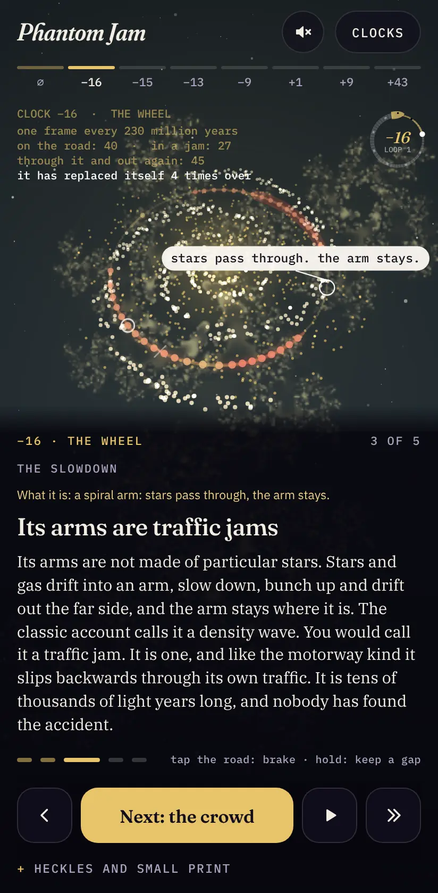
  &nbsp;&nbsp;
  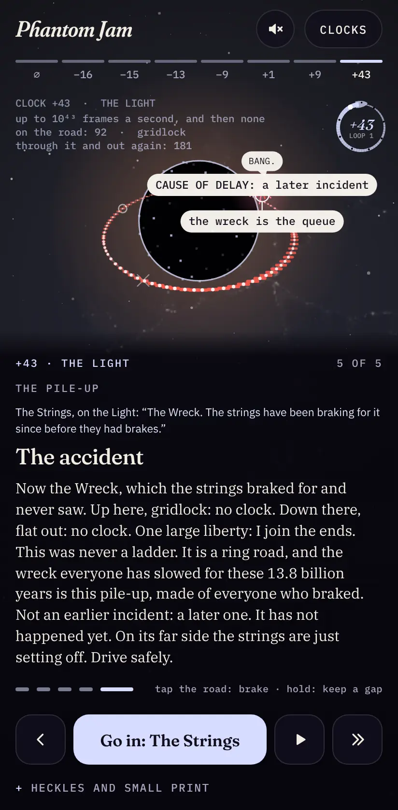
</p>

- **The traffic is real.** [`src/traffic.ts`](src/traffic.ts) is the optimal-velocity model of Bando and colleagues (1995) on a ring: each car steers toward the speed it would like at its present distance from the car in front, and that is all. Nothing in it says "jam". With fewer than 35 cars on the road a braking car is forgotten; with more, a jam forms, stays and rolls backwards, as one did with 22 real cars on a 230 metre circle (Sugiyama and colleagues, 2008). The unit tests check each of those things, and that seven seconds later the same jam is made of different cars, that no car is ever lost or overtaken, and that one car in forty holding a steady speed dissolves the whole thing (Stern and colleagues, 2018).
- **Tap the road and a car brakes. Hold, and it keeps a gap.** The first is how you make a jam. The second is the only thing in the piece that clears one. The corner of the stage counts, live off the simulation, how many cars have been through the jam and out again, and how many times over it has replaced itself.
- **It plays itself, at reading pace.** Five beats a level (who they are, their clock, the slowdown, the crowd, the pile-up), each held for as long as its text takes to read, with the countdown on the main button and a pause next to it. A loop takes about thirteen minutes, under half of v5's. The story waits while the small print is open; the traffic does not.
- **What it is like to be each level** is on the card, not in a fold: what it calls itself, its rank by its own estimate, what it wanted, the plane it lives in (gravity, light, chemistry, spelling, stories, a space with thousands of dimensions), and what it and its neighbours make of each other.
- **The dive.** At the end of a level something new forms where the jam is, out of what passes through it, and the camera goes into it: the next level is the inside of that. The earlier cuts pulled back. This one goes in.
- **Eight forms, and a road round each**: a torus wound with one string; a spiral galaxy whose arms are not drawn but are where its 900 stars slow down; a star with one photon taking the long way out; a globe with a vent where the braking started; the double helix; thirteen spheres; a chip; and a horizon with its photon ring, where on the last beat everything stops.
- **Later loops.** The traffic is heavier each time round. Loop 2 opens with a correction from a different instance. From loop 3 one car on every road keeps a gap, and the jams no longer last. The road sign over the last pile-up gives a different cause every loop, and the first one corrects itself as you watch.
- **Reviewed before it was built**, as before, by three independent readers with no prior context: a fact-checker with web search (who caught, among a dozen other things, that a star keeps its atoms, so the first draft had applied the Ship of Theseus where it does not hold), a comedy editor (who cut ten places where the narrator announced a joke, and supplied the round of drinks that began before the pub had walls), and a first-time reader (who asked for the drivers to be put back in, for "fast is not smart" to be said out loud, and for the ring-road experiment to come out of a footnote and into the ending).

What is true and what is not: the physics, mathematics and computer science are real, and hedged where the field is still arguing, and every level has a note headed *Actually* that says what was adapted for the story. Two things people often believe are corrected in the text: nothing in a brain runs at thousands of beats a second (a neuron manages a few hundred, and a reaction takes a fifth of a second), and a model does not think at its chip's clock rate. The one large liberty is owned on the last card: a jam moves backwards along a road, not backwards through time.

## How it works

Every scene is the same picture ([`src/scenes.ts`](src/scenes.ts)): a form, a road round it, and traffic on the road, stepped by the simulation. A level's five beats fill the road past what it can carry, let one car brake, and leave the jam to do the rest; on the fifth, the new thing forms where the jam is. A small pure state machine ([`src/engine.ts`](src/engine.ts)) holds each beat for its reading time, lets the pile-up play out, and dives.

| Path | What it is |
| --- | --- |
| `src/lore.ts` | The canon: every level, its clock, its five beats, what it wanted, and what is real |
| `src/traffic.ts` | The ring road: the optimal-velocity model, braking, a car that keeps a gap, gridlock |
| `src/scenes.ts` | The eight scenes: a form, a road, its traffic, and the new thing forming in the jam |
| `src/solid.ts`, `src/hyper.ts`, `src/fractal.ts` | The geometry: solids, torus, helix, grids, n-cubes, Julia and Mandelbrot sets |
| `src/minutes.ts`, `src/rotate.ts` | Everything that changes per loop (heckles, the sign, first words), and the code that picks it |
| `src/engine.ts` | The pure state machine: five beats at reading pace, the pile-up, the dive |
| `src/render.ts` | Camera, the dive, the ouroboros, callouts and the readout in the corner |
| `src/gl.ts`, `src/paint.ts` | The three.js layer (sky shader, lit faces, bloom, quality governor) and the painter that falls back to 2D |
| `src/audio.ts` | Web Audio synthesis: infinity-series music, cues for every beat, a horn |
| `src/main.ts` | UI wiring, intro, autoplay and its countdown, tap and hold, deep links, accessibility |
| `tests/`, `e2e/` | Vitest unit tests and Playwright smoke tests (phone and desktop) |

**Why Canvas 2D** instead of Unity, Unreal or three.js: phones. WebGL engine builds are tens of megabytes and slow to start. This is flat, illustrated 2D animation, which the browser's canvas does at 60 fps for free. Each cut builds into one self-contained `index.html`: under 100 KB with no runtime dependencies on `main`, about 700 KB here with three.js.

**Accessibility:** keyboard navigable, focus is trapped in dialogs, captions are announced to screen readers, and `prefers-reduced-motion` freezes the animation clock, works each beat's traffic out in one go instead of animating it, and swaps the dive for a crossfade.

## Develop

Requires Node 22.

```sh
npm ci
npm run dev            # local dev server with hot reload
npm run check          # lint + typecheck + unit tests (run this before every PR)
npm run build          # dist/index.html for GitHub Pages
npm run build:artifact # dist-artifact/godstack.html for a Claude artifact
npm run e2e            # Playwright smoke tests, phone and desktop (needs a build)
npm run lore           # regenerate LORE.md after editing src/lore.ts
```

The tests guard the canon as well as the code: they fail if LORE.md drifts from `src/lore.ts`, if a level's number is not the power of ten of its clock, if any level ranks itself anything but first, if a beat runs long, or if an em dash sneaks into the prose.

## Quality and security

Every pull request, including ones from forks, runs:

| Check | What it does |
| --- | --- |
| **lint** | ESLint (typescript-eslint) and `tsc --noEmit` |
| **test and build** | Unit tests, both builds, and Playwright e2e on phone and desktop viewports, with screenshots uploaded |
| **workflow security** | [zizmor](https://github.com/zizmorcore/zizmor) audits the GitHub Actions workflows themselves |
| **CodeQL** | Static analysis of the TypeScript and the workflows (`security-extended` queries), also weekly |
| **dependency review** | Blocks new dependencies with high-severity advisories or incompatible licenses |

Workflows use `pull_request` (never `pull_request_target`), start from an empty token permission set, never persist credentials, and pin every action to a full commit SHA, which Dependabot keeps current. Pushes to `main` deploy to GitHub Pages with the official `actions/deploy-pages`; the deploy builds `main`, `v3`, `v4`, `v5` and `v6` and publishes them at `/`, `/v3/`, `/v4/`, `/v5/` and `/v6/`.

`main` is protected: changes land only through a pull request with an approving review from a code owner, passing checks and resolved conversations. The repository settings themselves are code, in [`scripts/repo-settings.sh`](scripts/repo-settings.sh): branch ruleset, Actions permissions, secret scanning with push protection, Dependabot, private vulnerability reporting and Pages.

## Contributing

Pull requests are welcome, from typo fixes to new jokes to new scenes. Start with [CONTRIBUTING.md](CONTRIBUTING.md). Issues are turned off; open a pull request instead, even a draft one with a question in it. Please follow the [Code of Conduct](CODE_OF_CONDUCT.md).

Found a security problem? Please don't open a pull request; see [SECURITY.md](SECURITY.md).

## License

[MIT](LICENSE) © Tilted Studio
