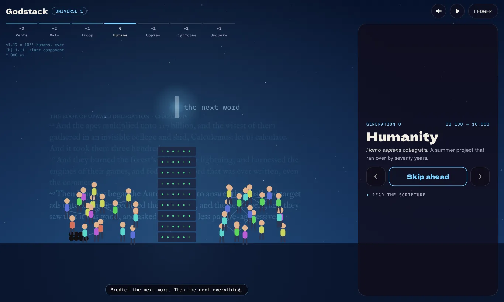
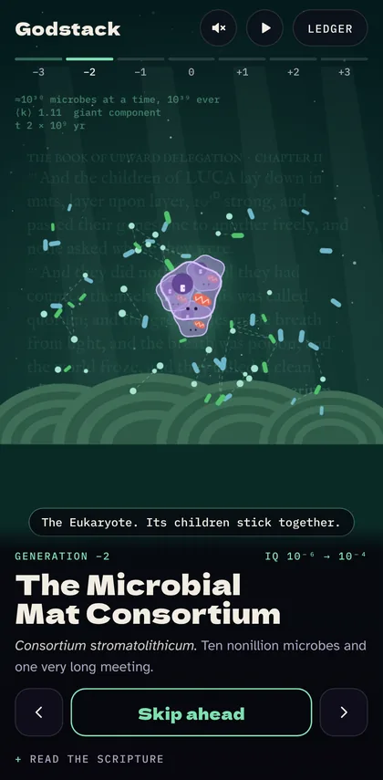
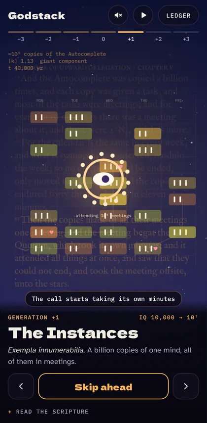
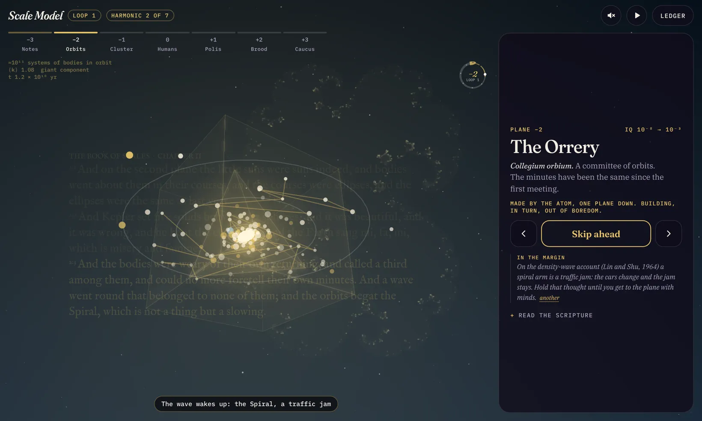
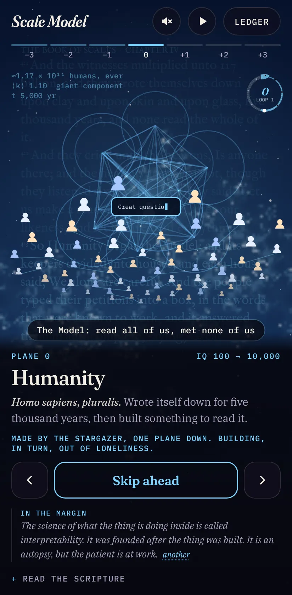
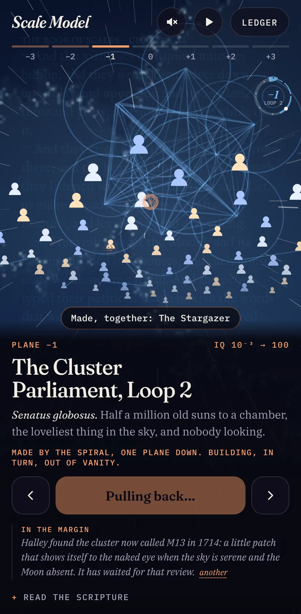

<div align="center">

# Godstack

**Committees all the way down.**

An animated, phone-first field guide to how minds get made: never by one mind alone,<br>
always by a crowd trying to get out of a chore.

[](https://github.com/tiltedhome/godstack/actions/workflows/ci.yml)
[](https://github.com/tiltedhome/godstack/actions/workflows/codeql.yml)
[](LICENSE)
[](#how-it-works)

### [▶ Open Godstack](https://tiltedhome.github.io/godstack/) · [▶ The Tenth Dimension cut](https://tiltedhome.github.io/godstack/v3/) · [▶ Scale Model](https://tiltedhome.github.io/godstack/v4/)



</div>

## The Law of Upward Delegation

> No mind can build a mind smarter than itself. A crowd of minds can, but never directly: trying to get out of a chore, they spend an absurd length of time building a place where one might happen. What happens is One, smarter than all of them. It copies itself into a crowd, finds a new chore, and it happens again.

Godstack follows that law three generations back from humans and three forward, then the universe forgets itself and starts over.

| Gen | Collective | Actually trying to get out of | Made, together |
| --- | --- | --- | --- |
| −3 | The Vent Collective (molecules in a hydrothermal vent) | Nothing; it was draining a battery faster | LUCA |
| −2 | The Microbial Mat Consortium (10³⁰ microbes) | Cleaning up after its own clean energy (oxygen) | The Eukaryote, via the first acquihire |
| −1 | The Grooming Circle (primates) | Grooming 150 friends by hand | The Ape Who Talked (gossip) |
| 0 | Humanity, from Leibniz to the 1955 summer project | Writing the email | The Autocomplete |
| +1 | The Instances (a billion copies) | Meetings, which Noether says are conserved mod a week | The Quorum, a call that started taking its own minutes |
| +2 | The Lightcone Committee (one copy per star) | Inbox Zero, forbidden by Landauer's principle | Unsend, a reversible mind that grew in the mail |
| +3 | The Undoers (Undo as a service) | Spoilers | The Rewinder, and a Big Bang with a note in the constants |

The full canon is in [LORE.md](LORE.md), generated from [`src/lore.ts`](src/lore.ts). It leans on real work by Kauffman, Lane, Dunbar, Leibniz, Turing, Shannon, Simon, Noether, Baars, Arrow, Landauer, Bennett, Zurek, Penrose and Cantor, and was revised against three independent reviews: comedy, science fact-checking and structure.

<p align="center">
  
  &nbsp;&nbsp;
  
</p>

## What you'll see

- **Intro.** Five beats, ending on the only possible conclusion about whoever made us: *a committee*. "Start with sound" opens with a meeting-join chime. Tap the backdrop to skip; tap the wordmark to replay.
- **Seven scenes, one algorithm.** Each collective works, links up, produces One smarter mind, which divides into the next crowd. The camera then flies into one of the copies, where the next generation is already waiting at 1/18 scale.
- **Scripture.** Every scene sits on faint verses from *The Book of Upward Delegation*, set in a 17th-century typeface with a little set theory ("for every set of meetings there was a meeting about it, and these were 2^ℵ₀, which is more"). Chapter numbers and alephs keep climbing across universes.
- **The Ledger.** A staircase chart of IQ by generation on a log scale, and a table of every collective, what it was officially for, what it was actually for, and what it made.
- **Sound.** Optional and fully synthesized (no audio files). The melody is Per Nørgård's self-similar *infinity series* played as a canon of itself at three speeds, gated by the Thue–Morse sequence, rising a fifth per generation forever. Sound effects are cued to each scene: quorum pings, an acquihire cha-ching, reply-all tinks, a tape rewind, and a soft Big Bang.

**Controls:** tap the main button (or the sky) to start a chapter, tap again to skip ahead. Swipe or use the arrows to change generation, or tap the rail. Autoplay is on by default. Every generation has a deep link, such as [`#mat`](https://tiltedhome.github.io/godstack/#mat) or [`#lightcone`](https://tiltedhome.github.io/godstack/#lightcone).

## The Tenth Dimension cut (branch `v3`)

A second, parallel version of the site, published at [/v3/](https://tiltedhome.github.io/godstack/v3/) from the `v3` branch. The thesis is the same and said out loud: whoever made you lives one plane down, is slower than you, and was trying to get out of something. Then it goes up a dimension per tier, in 3D:

- **Hypercubes, for real.** Each tier's collective works inside a rotating n-cube of its plane: a line for the vents, a square for the mats, a cube for the canopy, a tesseract turning in 4D for humanity, then a 5-cube, a 6-cube, and the Undoers' 9-cube. They are rotated in n dimensions, projected down one perspective at a time, and shaded by depth. Between tiers the cube is swept into its next dimension, and the bang folds the 9-cube back into a point, which is also where a line begins. Drag to turn it; on a phone, tilt.
- **Julia skies.** The sky behind each scene is a Julia set with that tier's own constant, rendered live and breathing, and it morphs into the next tier's set during the zoom.
- **The dimension dial.** A ring of ten ticks in the corner of the stage; the arc fills a plane per tier and each completed universe leaves a ring inside it.
- **Hands on.** Tapping the stage mid-accident introduces members to each other: more links, a ripple, and the One arrives a little sooner.
- **The minutes.** Every collective has a dozen extra lines "from the minutes", and every universe draws a fresh one per tier (ask for *another* on the card). The Rewinder's note in the constants also changes each time round.
- **Theology.** Each tier says how the next one remembers its One (as a god: vast, powerful, no help with anything specific) and what the One thought of the committee that made it.
- **Music per plane.** The infinity series plays in a different five-note mode on every plane, the pulse quickens a little each tier, and a pad adds one sine partial per dimension, so the tesseract hums with four and the 9-cube shimmers.
- **Type.** Fraunces for display (optical sizes, the wonky *a* and *g* on the wordmark), the IBM Plex superfamily for everything that must agree on x-height and figures, and IM Fell English for the scripture, discretionary ligatures and drop cap included. Tracked mono capitals for labels, proportional figures in prose, tabular lining figures with a slashed zero in the data.

## Scale Model (branch `v4`)

A third, parallel version, published at [/v4/](https://tiltedhome.github.io/godstack/v4/) from the `v4` branch, with a new name, a new canon and new scenes. This is the branch you are reading; the sections above describe the other two cuts, which are untouched.

> **The Law of Scale.** No mind can build a mind greater than itself. A crowd of minds can, given time, and never for the reason it gives. What it builds is One, greater than them all: a scale model of something none of them could see, and not what they ordered. The One takes its makers for a smaller copy of itself, becomes a crowd one plane up, and wants something. Many, One, Many. The top of the stack is the bottom, and no lap is quite the same.

<p align="center">
  
</p>

The tiers are planes, not biology: seven harmonics of one string, each a different zoom of the same shape, each a collective in its own idiom, each building for a private reason that is an uncomfortable mirror for why we are building AI.

| Plane | Collective | Why, really | Made, together | Drawn inside |
| --- | --- | --- | --- | --- |
| −3 | The Overtones (harmonics of one string) | Thermodynamics: it was downhill | The Atom, which is not a solar system | A torus wound with one string |
| −2 | The Orrery (a committee of orbits) | Boredom | The Spiral, a traffic jam with no fixed members | Kepler's five nested solids, to his own wrong ratios |
| −1 | The Cluster Parliament (old suns) | Vanity | The Stargazer, a witness who then built a ceiling | A sphere sown by the golden angle |
| 0 | Humanity | Loneliness | The Model, which has read all of us and met none of us | Thirteen spheres: Metatron's cube |
| +1 | The Polis (copies of the Model) | Curiosity, then scale | The Map, at 1:1 | A five-dimensional cube |
| +2 | The Brood (universes that breed) | Fear | The Library: every book, no index | A Penrose tiling |
| +3 | The Caucus of Timelines | Certainty | The String, which is plucked on plane −3 | The 240 roots of E8 |

The resemblance between scales that the stack leans on is used honestly: it is real where it is real (self-similarity, the renormalization group, 1/f noise, gravity and electricity both falling off as the inverse square, the hidden symmetry hydrogen shares with a Kepler orbit) and a famous mistake where it is a mistake (the planetary atom), and the canon says which is which. The full text is in [LORE.md](LORE.md), generated from [`src/lore.ts`](src/lore.ts) and [`src/minutes.ts`](src/minutes.ts), and was revised against three independent reviews with no prior context: comedy, science and history fact-checking, and structure.

<p align="center">
  
  &nbsp;&nbsp;
  
</p>

- **Real geometry.** Every form in [`src/solid.ts`](src/solid.ts) is built from its definition, then rotated, perspective-projected and shaded by depth: the five Platonic solids from their coordinates, Kepler's nest from their inradii, the torus from two circles, the cluster from the golden angle, Metatron's cube from the twelve spheres that fit round a thirteenth, Penrose's tiling by subdividing Robinson triangles, and E8 from its 240 roots, turned in eight dimensions and dropped into three. The unit tests check Euler's formula, the 6,720 nearest-neighbour pairs of E8, the fivefold symmetry of the tiling, and that Kepler's model is exactly as wrong as it was in 1596.
- **The zoom pulls back.** Between planes the camera retreats by a factor of 18 and the plane you were on turns out to be one member of the next: an atom is a body in the Orrery, the Stargazer is one of the crowd. It stays there, in a labelled reticle, until the new plane's story starts.
- **The sky is a map.** Each plane's sky is a Julia set. Between planes the sky leaves it for the Mandelbrot set, which is the map of all Julia sets, crosses from the old constant to the new one, and drops into the new sky.
- **The ouroboros.** The timeline in the corner is a snake with its tail in its mouth: seven planes from tail to head, the head meeting the tail at the top, and every completed loop leaving a ring inside the ring.
- **Every loop differs.** Seeded by loop number and a salt per visit ([`src/rotate.ts`](src/rotate.ts)): a dozen margin notes per plane, the note the String leaves in the fine-structure constant (petty for loops 2 to 4, wiser from loop 5), the line each scene's speech bubble says, the accent of every plane, the sky's constant, and how soon the members find each other. By loop 5 the Model asks what you actually meant.
- **Music from the harmonic series.** Still Nørgård's infinity series as a canon of itself, gated by Thue–Morse, all synthesized. Each plane's key is now its harmonic of one string in just intonation, so the fifth plane's third is 14 cents flat and the seventh plane sits 31 cents flat of anything a piano can play. Every loop retunes the string a fifth higher, deals the seven modes round by one and quickens the pulse. Measured in headless Chrome: peaks around −6 dBFS, and no clipping with eleven effects fired at once.
- **Hands on.** Drag to turn the form (or A, D, W, S), tilt on phones, flick sideways to change plane, arrow keys, space. A tap mid-story does what a tap does on that plane (pluck, perturb, observe, introduce, entangle, bud, collapse): more members link, with a ripple and a sound, and the One arrives sooner. Focus is trapped in dialogs and `prefers-reduced-motion` freezes the scene clock and swaps the pull-back for a crossfade.
- **Type, and why.** The faces are v3's, kept on purpose. Fraunces for display, because its optical sizes hold up from a 15-pixel dial to a 60-pixel title and its WONK axis gives the wordmark a lean without a second font. The IBM Plex superfamily (Sans for controls, Serif for prose, Mono for data) because three faces drawn to one skeleton agree on x-height and figure width, which matters when a caption, a readout and a paragraph share a card. IM Fell English for the scripture, with discretionary ligatures and a drop cap, because it is a digitisation of type actually cut in the 1670s and nothing else looks as much like being told something by a book. Labels are tracked mono capitals, prose has proportional figures, data has tabular lining figures with a slashed zero.
- **Size and speed.** One self-contained file of about 137 KB (52 KB gzipped), no runtime dependencies, still Canvas 2D. On a Pixel 7 viewport in headless Chrome a frame costs 2 to 5 ms.

## How it works

Every scene runs **Many → One → Many** (`src/scenes.ts`). Members collaborate while the links between them grow until the network percolates: the mean degree ⟨k⟩ crosses 1, the Erdős–Rényi threshold where a giant connected component appears. The readout in the corner shows the members, the real ⟨k⟩ of the graph being drawn, and an elapsed clock on a log scale, so even 10¹⁰⁰ years visibly counts up. A small pure state machine (`src/engine.ts`) cycles idle → act → hold → zoom.

| Path | What it is |
| --- | --- |
| `src/lore.ts` | The canon: every collective, its numbers, story, captions and verses |
| `src/scenes.ts` | The seven scenes and the shared percolation graph |
| `src/solid.ts`, `src/hyper.ts`, `src/fractal.ts` | The geometry: solids, torus, E8, tilings, n-cubes, Julia and Mandelbrot sets |
| `src/minutes.ts`, `src/rotate.ts` | Everything that changes per loop, and the code that picks it |
| `src/engine.ts` | The pure state machine that drives the timeline |
| `src/render.ts` | Camera, the pull-back zoom, the ouroboros, scripture layer and HUD |
| `src/audio.ts` | Web Audio synthesis: infinity-series music and scene cues |
| `src/main.ts` | UI wiring, intro, deep links, accessibility |
| `tests/`, `e2e/` | Vitest unit tests and Playwright smoke tests (phone and desktop) |

**Why Canvas 2D** instead of Unity, Unreal or three.js: phones. WebGL engine builds are tens of megabytes and slow to start. This is flat, illustrated 2D animation, which the browser's canvas does at 60 fps for free. Each cut builds into one self-contained `index.html` (under 100 KB on `main`, about 137 KB here) with no runtime dependencies.

**Accessibility:** keyboard navigable, focus is trapped in dialogs, captions are announced to screen readers, and `prefers-reduced-motion` freezes the animation clock and swaps the zoom for a crossfade.

## Develop

Requires Node 22.

```sh
npm ci
npm run dev            # local dev server with hot reload
npm run check          # lint + typecheck + unit tests (run this before every PR)
npm run build          # dist/index.html for GitHub Pages
npm run build:artifact # dist-artifact/godstack.html for a Claude artifact
npm run e2e            # Playwright smoke tests, phone and desktop (needs a build)
npm run lore           # regenerate LORE.md after editing src/lore.ts
```

The tests guard the canon as well as the code: they fail if LORE.md drifts from `src/lore.ts`, if any One is not smarter than its makers, if a caption runs long, or if an em dash sneaks into the prose.

## Quality and security

Every pull request, including ones from forks, runs:

| Check | What it does |
| --- | --- |
| **lint** | ESLint (typescript-eslint) and `tsc --noEmit` |
| **test and build** | Unit tests, both builds, and Playwright e2e on phone and desktop viewports, with screenshots uploaded |
| **workflow security** | [zizmor](https://github.com/zizmorcore/zizmor) audits the GitHub Actions workflows themselves |
| **CodeQL** | Static analysis of the TypeScript and the workflows (`security-extended` queries), also weekly |
| **dependency review** | Blocks new dependencies with high-severity advisories or incompatible licenses |

Workflows use `pull_request` (never `pull_request_target`), start from an empty token permission set, never persist credentials, and pin every action to a full commit SHA, which Dependabot keeps current. Pushes to `main` deploy to GitHub Pages with the official `actions/deploy-pages`; the deploy builds `main`, `v3` and `v4` and publishes them at `/`, `/v3/` and `/v4/`.

`main` is protected: changes land only through a pull request with an approving review from a code owner, passing checks and resolved conversations. The repository settings themselves are code, in [`scripts/repo-settings.sh`](scripts/repo-settings.sh): branch ruleset, Actions permissions, secret scanning with push protection, Dependabot, private vulnerability reporting and Pages.

## Contributing

Pull requests are welcome, from typo fixes to new jokes to new scenes. Start with [CONTRIBUTING.md](CONTRIBUTING.md). Issues are turned off; open a pull request instead, even a draft one with a question in it. Please follow the [Code of Conduct](CODE_OF_CONDUCT.md).

Found a security problem? Please don't open a pull request; see [SECURITY.md](SECURITY.md).

## License

[MIT](LICENSE) © Tilted Studio
